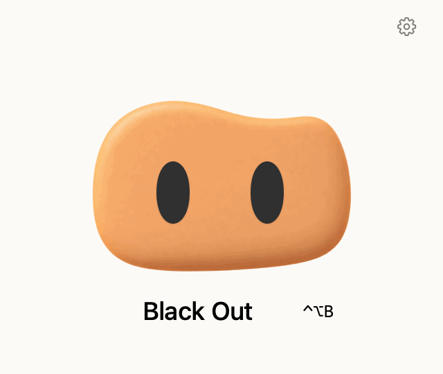

  

# Wink

**Black out your screens with one click.**

Wink started with a problem I had: my agent was still using my computer, and I wanted to step away without letting others see the screen or locking it and interrupting the agent. So I built this small macOS menu bar app. Click to darken your screens; click again when you return to bring them back.

English · [简体中文](README.zh-CN.md)

  

## Install

**macOS 13+ · Apple Silicon (M-series)**

[Installation guide](docs/development.md#installation)

## Keep in mind

- Blackout is not a screen lock. Content may remain faintly visible on some displays.
- Connecting or disconnecting a display may briefly expose screen content.

[Agent setup](docs/cli.md) · [Recovery](docs/development.md#recovery) · [Development](docs/development.md) · [MIT license](LICENSE)
